<div align="center">

# Kavach

### Every scam one of us reports becomes a warning for everyone's family.

A scam-safety companion you can text, with an iPhone app and family alerts that wait for a reply.

**Built at HackUTD 2026: Zero Day · T-Mobile Safe Signal track**

**[Explore the website](https://claude.ai/artifact/HNh8kvTVZoTW7qD86Aecxx?sk=A-QjMiiRMcFeyuankDzo7Q)** · **[Read the stories](https://claude.ai/artifact/HNh8kvTVZoTW7qD86Aecxx?sk=A-QjMiiRMcFeyuankDzo7Q#stories)** · **[Take the app tour](https://claude.ai/artifact/HNh8kvTVZoTW7qD86Aecxx?sk=A-QjMiiRMcFeyuankDzo7Q#tour)** · **[Set up locally](SETUP.md)**

NVIDIA Nemotron · SpacetimeDB · Photon · SwiftUI

</div>

## A calm app for the hard moments

Kavach helps older adults and people who feel less confident with technology check suspicious messages,
recognize scam calls, and reach someone they trust. Community reports inform each check; replies explain
the verdict and what to do next in plain words.

<table>
  <tr>
    <th align="center">Home</th>
    <th align="center">Check a message</th>
    <th align="center">Your network</th>
  </tr>
  <tr>
    <td align="center">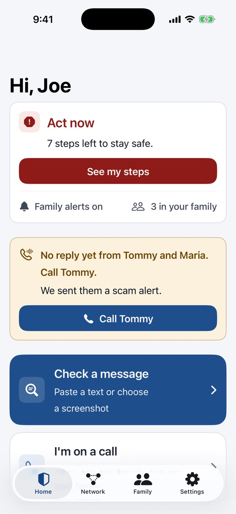</td>
    <td align="center">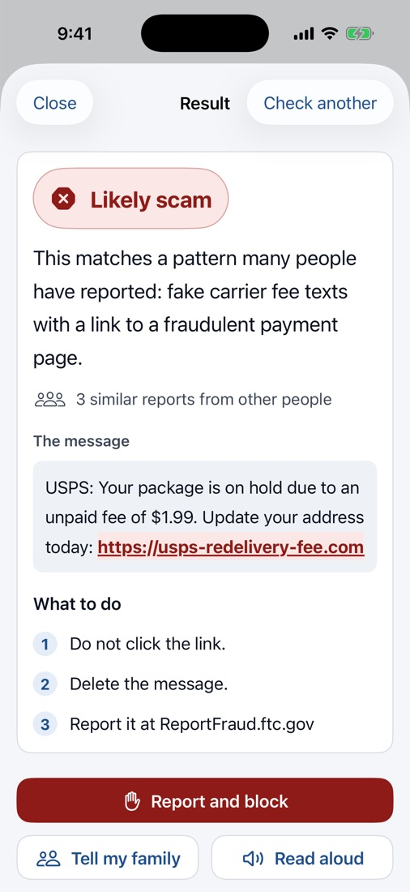</td>
    <td align="center">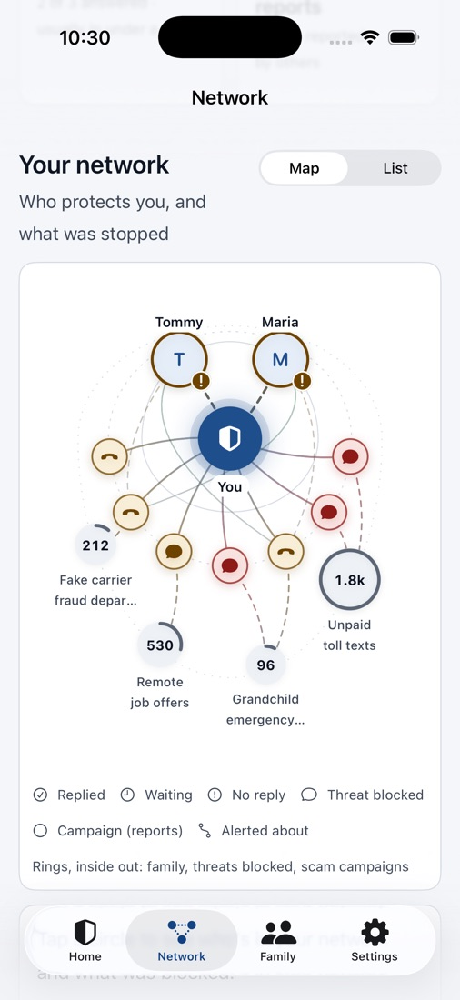</td>
  </tr>
  <tr>
    <td align="center">Status, open steps, and three big actions.</td>
    <td align="center">Paste, screenshot, or share. Verdict first.</td>
    <td align="center">Family and the threats reported by the community.</td>
  </tr>
  <tr>
    <th align="center">Your reports</th>
    <th align="center">Family</th>
    <th align="center">Accessibility Mode</th>
  </tr>
  <tr>
    <td align="center">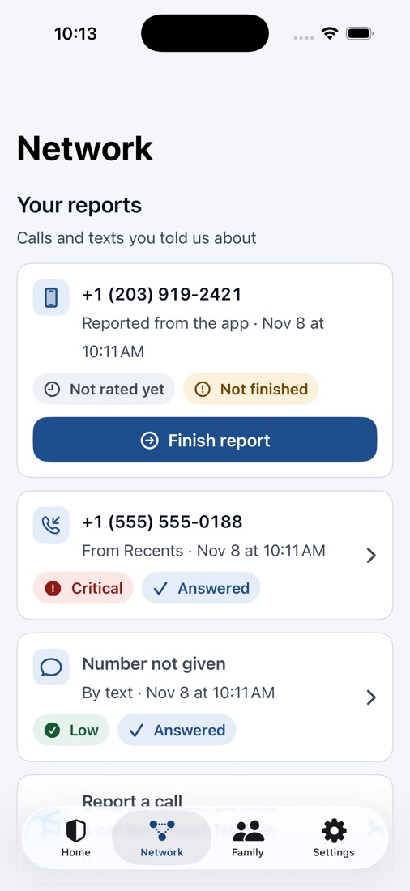</td>
    <td align="center">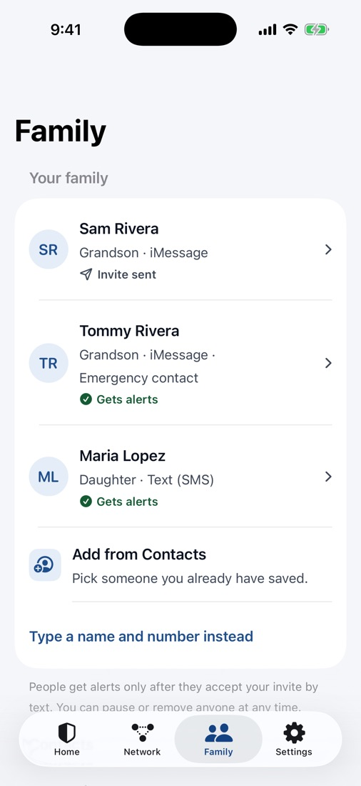</td>
    <td align="center">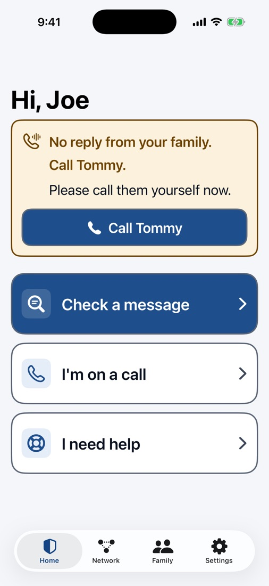</td>
  </tr>
  <tr>
    <td align="center">See what still needs your attention.</td>
    <td align="center">Who's told, who replied, and when to pause.</td>
    <td align="center">Bigger controls, simpler choices, read aloud.</td>
  </tr>
</table>

*Screenshots from [our website](https://claude.ai/artifact/HNh8kvTVZoTW7qD86Aecxx?sk=A-QjMiiRMcFeyuankDzo7Q). App screens use sample names and synthetic demo data.*

## Three ways Kavach helps

| Text Kavach | Keep family in the loop | Use the iPhone app |
| --- | --- | --- |
| Forward a suspicious text, ask about a request for money, or report a caller. Get a verdict and next steps in iMessage. | Chosen contacts receive plain-language alerts and are asked to reply. Reminders and follow-up warnings help when nobody answers. | See caller labels, open Call Companion, report calls, and follow recovery checklists. |

## From a worrying call to the next step

<table>
  <tr>
    <th align="center">During the call</th>
    <th align="center">After something goes wrong</th>
  </tr>
  <tr>
    <td align="center">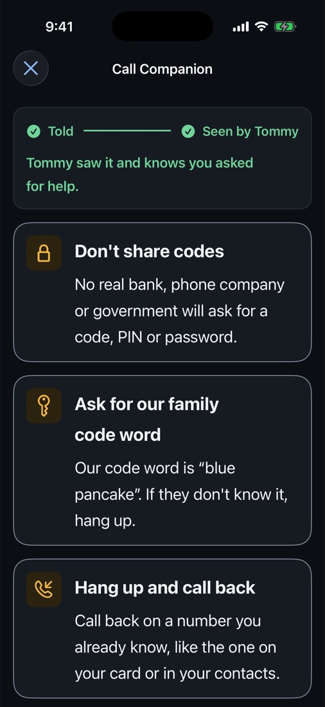</td>
    <td align="center">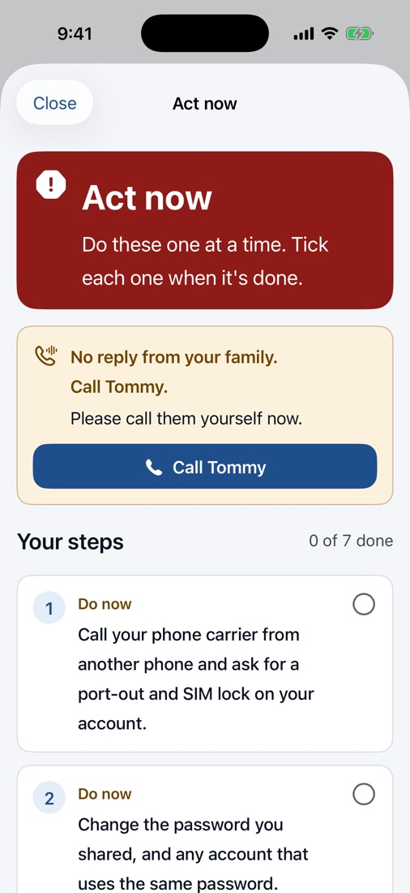</td>
  </tr>
  <tr>
    <td align="center">Safety reminders and live family reply status.</td>
    <td align="center">Numbered recovery steps based on what happened.</td>
  </tr>
</table>

<details>
<summary><strong>More app screenshots: reporting, follow-up, and sign-in</strong></summary>

| Report a call | Missed call result |
| :---: | :---: |
| 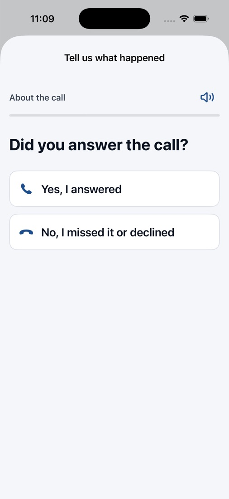 | 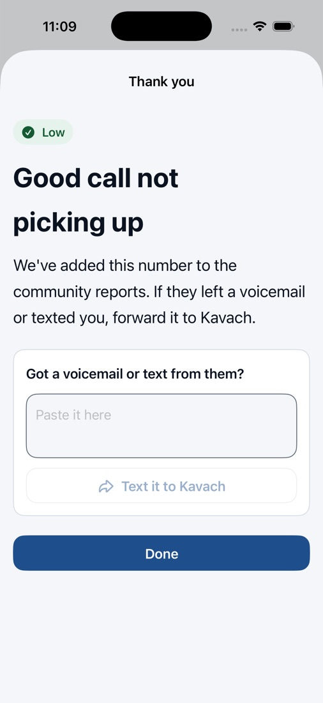 |

| After a call | Sign in |
| :---: | :---: |
| 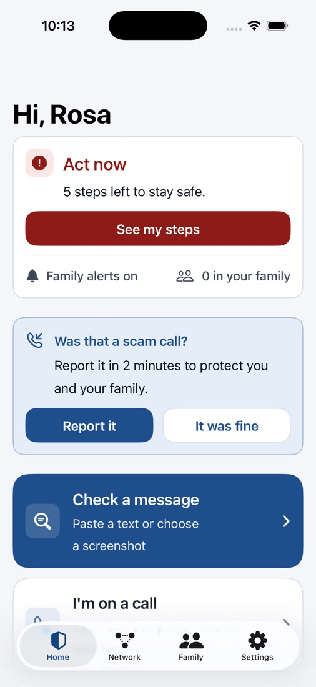 | 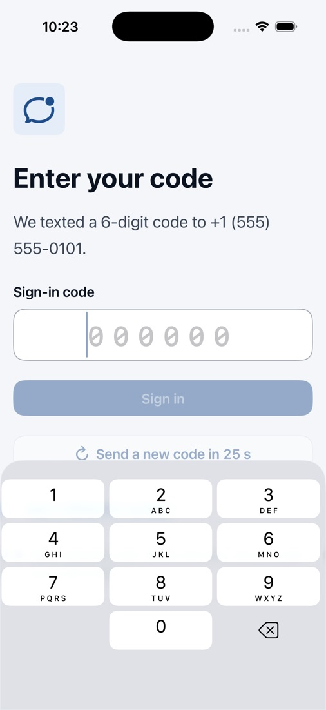 |

</details>

## Stories from the website

- **The bank that wasn't:** Call Companion offers safety reminders and asks family for help. After the call, fixed rules determine risk and recovery steps.
- **Too good to be true:** A prize text with a link gets a plain-language warning and instructions on what to do next.
- **“Should I?”:** Ask about a gift-card request and continue the conversation with follow-up questions.
- **“Hi Grandpa, it's me. New number.”:** Text `verify Raagdeep` to check with a relative on their saved number.
- **A missed call still counts:** Report a number without answering a long interview when you never picked up.
- **Silence is a signal too:** Family reminders and direct-call instructions follow an unanswered request for help.

**[See the conversations and full stories on the website →](https://claude.ai/artifact/HNh8kvTVZoTW7qD86Aecxx?sk=A-QjMiiRMcFeyuankDzo7Q#stories)**

## How it works

1. **Arrive:** A text reaches Kavach through Photon, or a call is reported from the iPhone.
2. **Search:** Kavach checks numbers, links, and similar scams against community reports.
3. **Judge:** NVIDIA Nemotron routes and analyzes the message and writes the reply, with NeMo Guardrails keeping the conversation focused on scams and safety.
4. **Act:** SpacetimeDB rules determine risk, queue replies and alerts, and track family responses.

Community reports stay internal. A model cannot lower a verdict below the rules and community evidence.

## Built with

| Technology | Role |
| --- | --- |
| **NVIDIA Nemotron on NIM** | Message routing, scam analysis, replies, and community similarity search. NeMo Agent Toolkit runs workflows; NeMo Guardrails constrains their scope. |
| **SpacetimeDB** | Shared state, risk rules, community evidence, scheduled reminders, access control, and the message outbox. |
| **Photon** | iMessage and SMS delivery through Spectrum, including inbound family replies. |
| **SwiftUI** | The iPhone app, caller labels, reporting and share extensions, App Intents, and Accessibility Mode. |

## Repository guide

- Spec: [`ScamShield Mesh Build Requirements for Claude Code.md`](ScamShield%20Mesh%20Build%20Requirements%20for%20Claude%20Code.md) (product renamed Kavach via `APP_DISPLAY_NAME`)
- Wire contracts: [`docs/CONTRACTS.md`](docs/CONTRACTS.md)

| Component | Stack | What it does |
| --- | --- | --- |
| `spacetime/` | SpacetimeDB 2.14 TypeScript module | All state, reducers, rule-based severity, community verdict floor, schedules, agent task queue, access views |
| `agents/` | Python, NeMo Agent Toolkit 1.9, NeMo Guardrails 0.24, NIM | All workflows; `search_community`; `/run/*`, `/app/*`, `/push`; polls `agent_task` |
| `photon-worker/` | TypeScript, `spectrum-ts` | iMessage/SMS in and out; text commands; outbox delivery with retries, SMS fallback, family groups |
| `ios/` | SwiftUI, iOS 26, XcodeGen | Six screens + interview, four extensions, App Intents, push |

## Run locally

Full instructions for a fresh Mac are in [`SETUP.md`](SETUP.md). The short version, once tools are installed:

```sh
spacetime start                         # separate terminal
cp .env.example .env                    # set SERVICE_CLAIM_KEY, AGENT_SERVICE_TOKEN, NIM_API_KEY
npm install && (cd spacetime && npm install) && (cd photon-worker && npm install)
(cd agents && uv sync)
npm run publish:local:clean && npm run tokens && npm run demo:reset
npm run start:local                     # agent service + iMessage worker (console)
scripts/text.sh +15555550101 "verify Tommy"
cd ios && xcodegen generate && open Kavach.xcodeproj   # then ⌘R, sign in as Joe +15555550101, code 000000
```

Without `NIM_API_KEY`, every workflow runs on deterministic fallbacks (heuristics plus community search
with lexical similarity), which is enough to rehearse the whole demo.

## Test status

| Suite | Result |
| --- | --- |
| Module smoke (`npm run smoke`) | 28/28 |
| agents unit / integration | 88 passed (1 skipped) / 14 passed |
| photon-worker | 115 passed, typecheck clean |
| iOS | simulator build succeeds; 27 XCTests passed (live against SpacetimeDB) |

Verified across components on one database: forwarded toll text → "Likely scam" reply; "verify Tommy" → Tommy
replies "not me" → Joe warned and family told; a family member's "ok" to a help request → Joe told they saw it;
explained family alerts via the agent task queue; template alerts after 20 s when the agent service is down.

## Not yet verified (needs credentials or devices)

- Real NIM calls (model ids, embeddings): no `NIM_API_KEY` was available.
- A real Photon line (iMessage groups, SMS fallback), APNs.
- On-device: Call Directory labels, the Report extension in Recents on iOS 26, Action Button, CallKit end-of-call, Face ID push actions.
- Delivery of real sign-in codes over Photon (the module queues them; demo numbers use `000000`).
